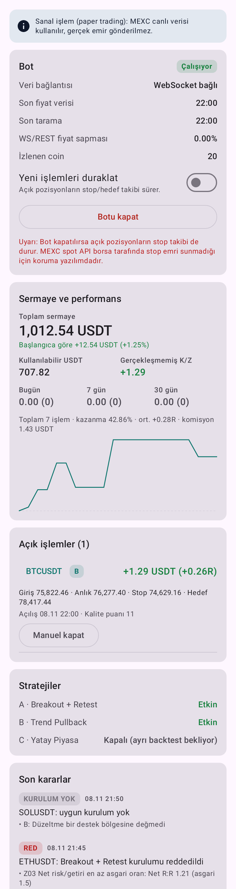
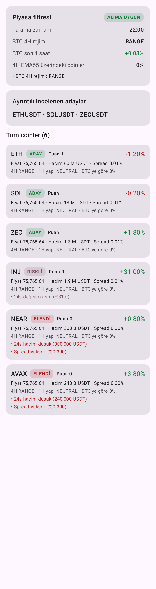
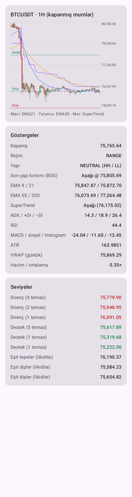
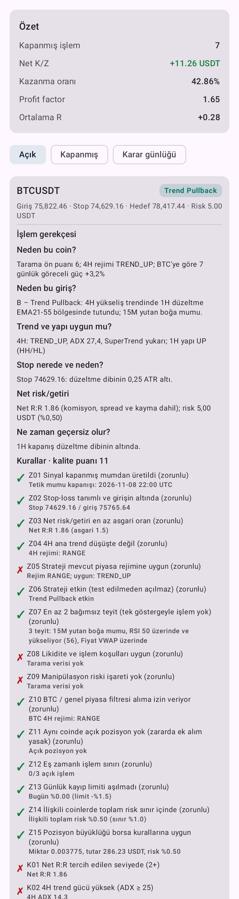
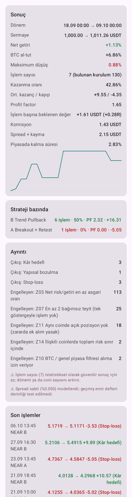
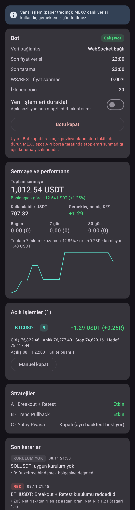

# CryptoScan Pro — MEXC Spot İşlem Botu

MEXC spot piyasasında (USDT pariteleri) çalışan, **kontrollü risk** ve **sistematik karar** odaklı otomatik
işlem botu. Android uygulaması (Türkçe kumanda paneli) + platformdan bağımsız Kotlin çekirdeği + komut satırı.

> **Durum: V1 — sanal işlem (paper trading).** MEXC canlı verisi kullanılır, **gerçek emir gönderilmez**,
> API anahtarı istenmez. Aşağıdaki backtest sonuçları stratejilerin henüz kâr avantajı göstermediğini
> söylüyor; bu yüzden gerçek parayla kullanım (V2) için hazır değildir.

**Kalite > İşlem sayısı · Risk kontrolü > Kâr beklentisi · Kanıtlanmış strateji > Tahmin**

## Modüller

| Modül | İçerik |
| --- | --- |
| `core/` | Saf Kotlin/JVM (Android bağımlılığı yok): MEXC veri katmanı, göstergeler, piyasa yapısı, tarama, stratejiler, kural motoru, risk, sanal hesap, canlı motor, backtest |
| `app/` | Android: 7/24 ön plan servisi + Türkçe kumanda paneli (Panel, Tarama, Coin detayı, İşlemler, Backtest, Ayarlar) |
| `cli/` | Komut satırı: `scan`, `backtest`, `paper` (aynı çekirdek; bilgisayarda/sunucuda 7/24 çalıştırılabilir) |

Çekirdek Android'den bağımsız olduğu için motor, ileride telefondan bağımsız bir sunucuda da aynı kodla
çalıştırılabilir. Gerçek parayla 7/24 işlemde telefonun tek yürütücü olması bağlantı/uyku riski taşır.

## Ekranlar

Gerçek MEXC verisiyle (BTC/NEAR) Robolectric üzerinde çizilmiş görüntüler (`docs/screenshots`):

| Panel | Tarama | Coin detayı |
| --- | --- | --- |
|  |  |  |
| **İşlem gerekçesi ve kurallar** | **Backtest** | **Koyu tema** |
|  |  |  |

## Akış

```
Her 15M mum kapanışı (+3 sn, sunucu saatine göre)
  → kapanmış mumlar REST ile alınır, süreklilik doğrulanır (bozuksa geçmiş yeniden yüklenir)
  → Tarama: izleme listesi + likiditeye göre ek coinler
      → elenir: işlem yapılamayan, hacmi düşük, spread'i geniş, emir defteri sığ
      → işaretlenir: aşırı 24s hareket, yüksek fitil oranı, ani hacim patlaması (manipülasyon riski)
      → BTC / genel piyasa filtresi (BTC 4H düşüş trendi ya da 4 saatte sert düşüş → alım yok)
      → ön puanla en iyi 2–4 aday
  → Aday başına: 4H rejimine uygun strateji(ler) → kurulum
  → 15 zorunlu kural (biri bile sağlanmazsa işlem YOK) + 11 kalite kuralı (puan)
  → Risk: %0,5 risk ile pozisyon büyüklüğü, borsa hassasiyeti/asgari tutar
  → Sanal giriş (anlık alış fiyatı sinyalden %0,3'ten fazla kaçtıysa iptal)
Açık pozisyon: stop/hedef WebSocket fiyatlarıyla anlık, yapısal bozulma 1H kapanışlarında izlenir.
```

Her karar (açılan, reddedilen, kurulum bulunamayan, kapanan) gerekçesiyle **karar günlüğüne** yazılır. Açılan her
işlem notun 6 sorusunu yanıtlar: *Neden bu coin? Neden bu giriş? Trend ve yapı uygun mu? Stop nerede ve neden?
Net R:R kaç? Ne zaman geçersiz olur?*

## Tasarım notuna göre durum

| Bölüm | Durum |
| --- | --- |
| 2. MEXC API | ✅ REST + protobuf WebSocket (öncelikli), 30 kanal/bağlantı paylaştırma, PING, 60 sn veri yoksa ve 23 saatte bir yeniden bağlanma, üstel geri çekilme; WebSocket kopuksa REST yedeği ve dakikalık REST doğrulaması. Kapanmamış mum sinyal sayılmaz. |
| 3. Coin tarama | ✅ BTC, ETH, SOL, NEAR, ZEC, INJ, AVAX + likiditeye göre 15 ek coin (ayarlanabilir 0–30) |
| 4. Teknik analiz | ✅ 4H: EMA, SuperTrend, ADX, yapı (HH/HL/LH/LL, BOS). 1H: S/R, FVG, order block, likidite (eşit tepe/dip), VWAP, R:R. 15M: mum kapanışı, hacim, RSI, MACD, EMA tetikleri. 5M: yalnız izleme (karar vermez). |
| 5. Stratejiler | ✅ A Breakout+Retest, B Trend Pullback; C Yatay piyasa **varsayılan kapalı** (ayrı backtest gerekli). Seçim 4H rejimine göre. |
| 6. Kural sistemi | ✅ Motor + JSON yapılandırma. ⏳ **60 kuralın metni henüz eklenmedi** (varsayımla doldurulmadı) |
| 7. Risk | ✅ Tablodaki tüm değerler; ayarlanabilir |
| 8. Emir yönetimi | ✅ Sanal. ⚠ Gerçek emir V2'de; aşağıdaki MEXC bulgusuna bakın |
| 9. Yapay zekâ | ⏳ V3 |
| 10. Kontrol paneli | ✅ Android (Türkçe). ⏳ Telegram bildirimi |
| 11. Test | ✅ Backtest (Aşama 1) ve canlı veriyle sanal işlem (Aşama 2) |

## MEXC ile ilgili doğrulanmış bulgular (Kasım 2026)

1. **Spot API'de stop emri türü yok.** Desteklenen türler yalnızca `LIMIT, MARKET, LIMIT_MAKER,
   IMMEDIATE_OR_CANCEL, FILL_OR_KILL` (resmi doküman, ENUM tanımları; canlı `exchangeInfo` de bunları gösteriyor).
   Notun 8. bölümündeki kritik şart bu yüzden **sağlanmıyor**: borsa tarafında koruyucu stop kurulamaz, koruma
   yalnızca yazılım stopuyla olur. V2'de gerçek paraya geçmeden önce bu riskin nasıl yönetileceğine karar verilmeli
   (ör. botun kesintisiz çalıştığı sunucu, bağlantı kopmasında pozisyonu kapatma politikası, küçük sermaye).
2. **Mum sınırı pratikte 500.** Doküman 1000 dese de `klines` istek başına en fazla 500 mum döndürüyor ve yalnız
   `startTime` verilirse onu yok sayıp en son mumları veriyor. Geçmiş yükleyici iki ucu da gönderip son mumdan
   devam eder.
3. **Likidite ince.** USDT paritelerinden yalnız 13'ü 2M, 29'u 1M USDT'nin üzerinde 24s hacme sahipti. NEAR ve
   AVAX'ın MEXC hacmi ~0,3M, ZEC ~1,3M idi; bu coinler tarama filtresinde sık sık elenir. Bu yüzden asgari
   hacim varsayılanı 1M (Ayarlar'dan değiştirilebilir).
4. Komisyon: `exchangeInfo` taker %0,05, maker %0. WebSocket akışı protobuf (`wss://wbs-api.mexc.com/ws`).

## Backtest sonuçları (dürüst özet)

Ayarlar varsayılan (risk %0,5, asgari net R:R 1,5, A+B etkin), 7 coinlik izleme listesi, komisyon + 0,05 % kayma
+ 0,05 % spread dahil:

| Dönem | Net getiri | BTC al-tut | Maks. düşüş | İşlem | Kazanma | Profit factor |
| --- | --- | --- | --- | --- | --- | --- |
| 90 gün (Ağu–Kas 2026) | **−2,7 %** | +18,4 % | 7,2 % | 44 | 27 % | 0,80 |
| 180 gün (May–Kas 2026) | **−9,7 %** | −6,2 % | 10,6 % | 75 | 21 % | 0,58 |

- Strateji A (Breakout + Retest) iki dönemde de belirgin zararda (kazanma ~%10).
- Strateji B (Trend Pullback) 90 günde PF 1,28, 180 günde PF 0,82.
- Strateji C tek başına 180 günde yalnız 4 işlem üretti; karar vermek için yetersiz.
- Kurulumları en çok engelleyen kural "Net R:R ≥ 1,5" (Z03); yani motor zayıf kurulumları zaten eliyor.

Sonuç: Mevcut parametrelerle **kanıtlanmış bir avantaj yok**; gerçek paraya geçilmemeli. Sonraki adım 60 kuralın
eklenmesi ve stratejilerin farklı dönemlerde (aşırı uyum yapmadan, ileri test ile) iyileştirilmesi.
Backtest'i Android'de *Backtest* sekmesinden ya da `cryptoscan backtest` ile yeniden çalıştırabilirsiniz.

## 60 kuralı ekleme

Kurallar `core/src/main/resources/rules/default-rules.json` dosyasındadır. Yerleşik kalite kuralları kapatılabilir
ve ağırlıkları değiştirilebilir; **zorunlu kurallar kapatılamaz**. 60 kural kod yazmadan `custom` listesine eklenir:

```json
{
  "id": "R12",
  "title": "4H ADX trend gücünü teyit ediyor",
  "group": "MANDATORY",
  "condition": "h4.adx >= 25 and h4.plusDi > h4.minusDi",
  "source": "60 kural listesi, madde 12"
}
```

Koşul dili: `h4.`, `h1.`, `m15.`, `btc.h4.`, `btc.h1.` ön ekleriyle `close, emaFast, emaMid, emaSlow, emaTrend,
rsi, macd, macdSignal, macdHistogram, atr, adx, plusDi, minusDi, superTrend (1/-1), vwap, volume, volumeAverage,
regime, trend`; önceki mum için `h1.prev.rsi`. Ayrıca `setup.rr, setup.stopDistancePercent, setup.confirmations,
setup.confluences, coin.spread, coin.volume24h, coin.change24h, market.breadth`. İşleçler `> >= < <= == !=`,
koşullar `and`/`ve` ile birleşir. Hatalı yazılmış bir zorunlu kural işlemi **engeller** (güvenli taraf) ve
Ayarlar'da gösterilir. Bu dille ifade edilemeyen kurallar `BuiltInRules` içine kodla eklenir.

## Risk parametreleri

| Parametre | Değer | Kaynak |
| --- | --- | --- |
| İşlem başına risk | %0,5 | Tasarım notu |
| Günlük kayıp limiti | %1,5 (gün başı özsermayeye göre, gerçekleşmemiş dahil) | Tasarım notu |
| Eş zamanlı işlem | en fazla 3 | Tasarım notu |
| Asgari / tercih edilen net R:R | 1,5 / 2+ | Tasarım notu |
| Kaldıraç, short, zararda ek alım | yok / yok / yasak | Tasarım notu |
| Pozisyon üst sınırı | sermayenin %30'u | Test varsayımı (notta yok) |
| İlişkili coin toplam riski | %1 (1H getiri korelasyonu ≥ 0,7) | Test varsayımı (notta yok) |
| Kayma / yarım spread | %0,05 / canlı spread (yoksa %0,025) | Test varsayımı |

## Kullanım

**Android:** APK'yı kurun → *Panel* → *Botu başlat*. Bot ön plan servisi olarak çalışır, bildirim çubuğunda durum
gösterir, cihaz yeniden başlarsa otomatik devam eder. 7/24 için *Ayarlar → 7/24 çalışma → Muafiyet iste* ile
pil optimizasyonu muafiyeti verin. *Yeni işlemleri duraklat* açık pozisyonların takibini sürdürür; *Botu kapat*
takibi de durdurur.

> Not: Pil optimizasyonu muafiyetini doğrudan istemek Play Store politikasına uymaz; kişisel kullanım içindir.

**Komut satırı** (JDK 17+):

```bash
./gradlew :cli:installDist
cli/build/install/cryptoscan/bin/cryptoscan scan
cli/build/install/cryptoscan/bin/cryptoscan backtest --days 90 --symbols BTC,ETH,SOL --strategies A,B --out rapor.json
cli/build/install/cryptoscan/bin/cryptoscan paper --data ./cryptoscan-data   # 7/24 sanal işlem
```

## Derleme ve testler

```bash
./gradlew :core:test                  # 62 çekirdek testi
./gradlew :core:test -Plive           # + gerçek MEXC'ye bağlanan duman testleri
./gradlew :app:testDebugUnitTest      # 7 ekran çizim testi (Robolectric) + biçimlendirme testleri
./gradlew :app:testDebugUnitTest -Pscreenshots   # ekran görüntülerini app/build/outputs/roborazzi'ye kaydeder
./gradlew :app:lintDebug :app:assembleDebug
```

Maven Central'a erişimi kısıtlı ortamlarda Robolectric'in Android çalışma ortamı için
`ROBOLECTRIC_REPO_URL=https://maven-central.storage-download.googleapis.com/maven2` ayarlanabilir.

Doğrulama: göstergeler (EMA, RSI, MACD, ATR, ADX/DI, SuperTrend) gerçek BTC verisinde **pandas-ta** ve **ta**
kütüphaneleriyle karşılaştırılır; analizin gelecek veriye bakmadığı, kesilmiş seriyle aynı sonucu verdiği test
edilir; protobuf çözücü gerçek MEXC mesajıyla test edilir; backtest gerçek NEAR/BTC verisiyle regresyon testine sahiptir.

Gereksinimler: JDK 17+ (21 önerilir), Android SDK 37. Sürümler: AGP 9.5, Gradle 9.9, Kotlin 2.4, Compose BOM 2026.09,
OkHttp 5.5, minSdk 26.

## Yol haritası

- **V2:** API anahtarı (çekim yetkisi kapalı, IP kısıtlı, Android Keystore ile şifreli), MEXC Spot Testnet yoksa
  çok küçük sermaye; stop emri olmadığı için yazılım stopu güvenlik politikası; Telegram bildirimleri; sunucu modu.
- **V3:** Portföy raporları, YZ destekli haber/kayıp analizi (emir yetkisi olmadan), haftalık rapor.
- **V4:** Kanıtlanmış stratejilerin rejime göre otomatik seçimi.

## Uyarı

Bu yazılım yatırım tavsiyesi değildir. Kripto para işlemleri yüksek risk içerir; hiçbir backtest gelecekteki
sonucu garanti etmez.
