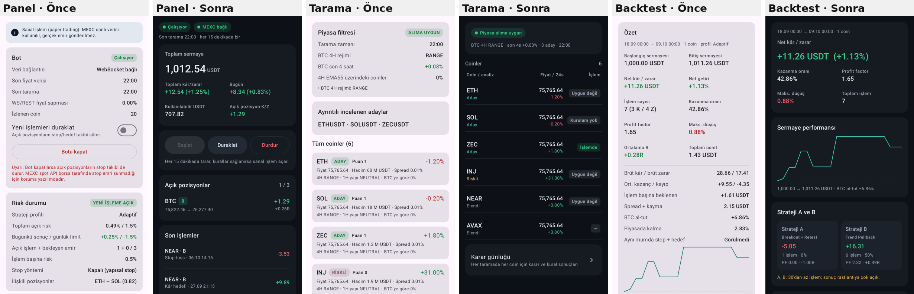

# Arayüz sadeleştirme (V2.2 · 10 Kasım 2026)

İlke: **basit görünüm, gelişmiş altyapı.** Bu çalışma yalnız arayüzü değiştirdi. Strateji, risk hesabı, backtest
algoritması, MEXC bağlantısı, botun arka planda çalışma düzeni ve kayıtlı veriler değişmedi. `core` modülünde
hiçbir dosyaya dokunulmadı. Ayrıntılı veriler silinmedi; açılır bölümlere ya da alt sayfalara taşındı.

## Genel

- **Koyu tema varsayılan.** Zemin `#0D1117`, kartlar bir ton açık (`#161B22`) ve kenarlıksız.
- **Kontrast:** Ana metin kart üzerinde yaklaşık 14:1, ikincil metin yaklaşık 7:1 kontrastta.
- **Renk anlamı:** Yeşil yalnız kâr ve olumlu durum, kırmızı yalnız zarar ve risk uyarısı, sarı uyarı için.
  Turkuaz vurgu rengi kâr/zarar anlamı taşımaz.
- **Yazı:** Tutarlı ölçek (başlık 16–20 sp, gövde 14 sp). Rakamlar eşit genişlikli (tabular), alt alta hizalı.
- **Boşluklar:** Ekran kenarında 16 dp, kartlar arasında 12 dp.
- **Dokunma alanları:** Tüm satır, düğme ve anahtarlarda en az 48 dp.
- **Taşma yok:** Uzun metinler sarılıyor ya da üç noktayla kısalıyor. Yatay kaydırılan satırlar kaldırıldı;
  filtre çipleri alt satıra iniyor.
- **İşlem modu:** Üst çubukta her ekranda **PAPER** etiketi var.
- **Alt sayfalar** (geri okuyla): coin analizi, işlem ayrıntısı, karar günlüğü, olay günlüğü.

## Ekranlar

### Panel

Yukarıdan aşağıya:

1. **Durum:** bot durumu (Çalışıyor / Duraklatıldı / Durduruldu / Hata), MEXC bağlantı göstergesi, son tarama
   saati.
2. **Sermaye:** toplam sermaye; toplam kâr/zarar, bugünkü değişim, kullanılabilir USDT, açık pozisyon K/Z.
3. **Kontrol:** Başlat, Duraklat, Durdur.
   - Duraklat yeni işlemleri durdurur; açık pozisyonların takibi sürer.
   - Durdur onay ister ve açık pozisyon varsa stop takibinin de duracağını söyler.
4. **Açık pozisyonlar:** coin, strateji, giriş → anlık fiyat, K/Z, R. Dokununca işlem ayrıntısı açılır.
5. **Son işlemler:** son 3 işlem ve olay günlüğü bağlantısı.
6. **Risk ve sistem ayrıntıları** (kapalı): risk sınırları, performans (bugün/7/30 gün), sermaye grafiği,
   bağlantı, çalışma oranı, kesintiler.

Önceki paneldeki her bilgi korunuyor; yalnız yeri değişti. Manuel kapatma işlem ayrıntısına taşındı.

### Tarama

- Piyasa filtresi tek kartta.
- Coin listesinin her satırında: coin, analiz durumu (Aday / Filtreyi geçti / Riskli / Elendi), fiyat, 24 saatlik
  değişim, işlem uygunluğu (İşlemde / Uygun / Uygun değil / Kurulum yok / İzleniyor).
- Kurallar ana listede gösterilmiyor. Karar günlüğü alt sayfada.

**Coin analizi** (satıra dokununca):

- Fiyat ve analiz/işlem durumu.
- Son karar ve **işlem açılmama gerekçesi**: tarama nedenleri ve geçmeyen zorunlu kurallar.
- **4H trend:** rejim, EMA21/55, ADX, SuperTrend, yapı.
- **1H işlem planı:** A ve B için giriş/stop/hedef, net R:R, **giriş ve iptal koşulu**. Kurulum yoksa nedeni
  yazılıyor.
- **15M giriş teyidi:** tetik mumu ve teyitler.
- Grafik: 15M/1H/4H.
- Kapalı bölümler: tüm göstergeler, seviyeler, kural sonuçları.

Plan, motorun kullandığı strateji koduyla kapanmış mumlardan hesaplanıyor. Ekran yalnız gösteriyor; işlem kararını
yine motor ve kurallar veriyor.

### İşlemler

- **Açık işlemler | Geçmiş** sekmeleri.
- Açık pozisyon kartında: coin, alış, güncel fiyat, K/Z, stop, hedef. Bekleyen limit emirleri iptal düğmesiyle
  aynı sekmede.
- Geçmiş sekmesinde: kısa özet (net, işlem, kazanma, PF), işlem kartları ve olay günlüğü bağlantısı.
- **İşlem ayrıntısı** (dokununca):
  - Sonuç ve fiyatlar.
  - 15M grafik (kendiliğinden yüklenir).
  - Altı soruluk gerekçe.
  - Ayrıntılar, kurallar.
  - Coin analizine geçiş.
  - Açık pozisyonu manuel kapatma (onaylı).

### Backtest

1. Yalnız beş ölçü: net kâr/zarar, kazanma oranı, profit factor, maksimum düşüş, toplam işlem.
2. Sermaye performans grafiği.
3. Strateji A ve B yan yana kısa kartlarda; tüm ölçü tablosu açılır bölümde.
4. İşlem geçmişi hizalı kartlarda: giriş ve çıkış satırları ayrı, fiyat sağa hizalı. Strateji ve aya göre
   süzülebiliyor. Dokununca ayrıntı açılıyor.
5. Kapalı bölümler:
   - Ayrıntılı ölçüler (brüt kâr/zarar, ortalama R, ücret, spread/kayma, aylık değişim).
   - Çıkış nedenleri ve engelleyen kurallar.
   - Gölge işlemler.

Test ayarları sonuç gelince tek satırlık özete kapanıyor. "A ve B ayrı" sonucu önce 5 ana ölçüyü gösteriyor; iki
yarı ve tüm ölçüler açılır bölümlerde.

### Ayarlar

Altı kategori; hepsi açılır kart ve başlığın altında mevcut değerin özeti var:

| Kategori | İçerik |
| --- | --- |
| Bot kontrolü | Yeni işlemleri duraklat, pil optimizasyonu muafiyeti |
| Strateji ayarları | A/B/C anahtarları, profil |
| Risk yönetimi | İşlem başı risk, günlük limit, en fazla işlem, asgari R:R |
| MEXC bağlantısı | Mod, veri bağlantısı, API anahtarının kullanılmadığı |
| Bildirimler | İzin durumu, Android bildirim ayarlarına geçiş |
| Gelişmiş ayarlar | "Teknik parametreleri göster" anahtarı |

Gelişmiş anahtar açılınca şunlar görünür:

- Risk kartında: pozisyon üst sınırı, toplam risk sınırı, ATR çarpanı, ek coin, asgari hacim.
- Strateji kartında: rejim filtresi, stop yöntemi.
- Gelişmiş kartında: deneysel emir/çıkış seçenekleri, kural listesi, sanal hesabı sıfırlama.

Varsayılan değerler değişmedi.

## Korunan özellikler

- Bot başlat / durdur, yeni işlemleri duraklat, açık pozisyonu manuel kapatma, bekleyen emri iptal.
- Karar günlüğü (coin süzgeci, kural ayrıntıları), olay günlüğü, işlem grafikleri, altı soruluk gerekçe.
- Backtest: tek test, A ve B ayrı, profil karşılaştırması, işlem ayrıntı grafiği, 5M doğrulama, gölge işlemler.
- Ayarlar: risk alanları, strateji, profil, rejim filtresi, stop yöntemi, deneysel emir seçenekleri, kurallar,
  sanal hesap, pil muafiyeti.
- Çekirdek kod, kayıt dosyaları (portfolio.json, settings.json, karar günlüğü) ve ön plan servisi aynı.

## Testler

| Test | Sonuç |
| --- | --- |
| Çekirdek birim testleri | 110 geçti, 2 canlı test atlandı (değişiklik yok) |
| Ekran görüntüsü, 400 dp genişlik | 14 ekran, çökme yok |
| Aynı ekranlar küçük telefonda (320 × 640 dp) | 14 ekran, çökme yok |
| Dokunma testleri | 7 test geçti |
| Android lint | Sorun yok |
| APK | 2.2.0-paper derlendi |

Dokunma testleri şunları doğruluyor:

- Durmuş bot yalnız Başlat'a izin veriyor.
- Çalışan bot Duraklat'ı uyguluyor; Durdur onaydan sonra çalışıyor.
- Duraklatılmış bot Başlat ile devam ediyor.
- Panel satırları işlem ayrıntısını ve olay günlüğünü açıyor.
- Açılır bölüm dokununca açılıyor.
- İşlemler sekmeleri ve kart dokunuşları çalışıyor.
- Manuel kapatma onay istiyor.

Ekran görüntüleri gözle de kontrol edildi. Görülen sorunlar düzeltildi:

- Küçük ekranda kontrol düğmesi yazıları kesiliyordu.
- A/B kart başlıkları kısalıyordu.
- Risk özetinde yüzde işareti eksikti.
- 4H kartında satır sarılıyordu.
- Tablo etiketi kısalıyordu.

**Sınır:** Testler Robolectric üzerinde çizim ve dokunma benzetimidir. Gerçek bir Android telefonda (farklı yazı
boyutu, gece modu, gerçek kaydırma hissi) denenmedi.
